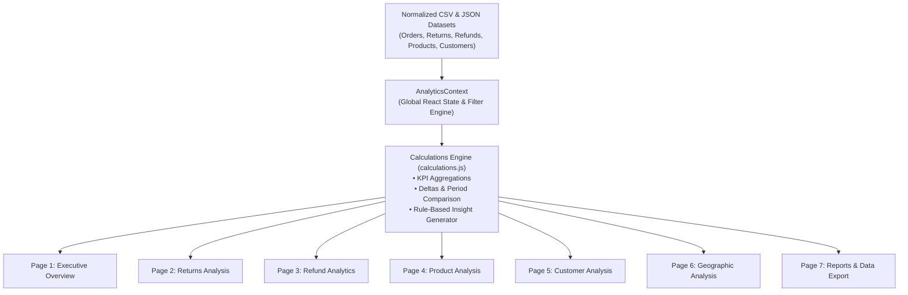
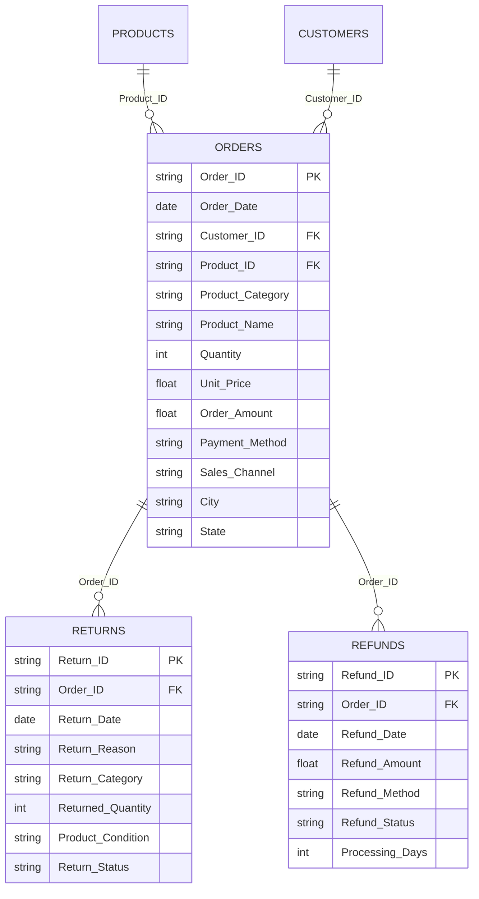

# 💎 OmniReturn | E-commerce Returns & Refunds Analytics Platform

> A modern, responsive, and interactive Business Intelligence platform for analyzing e-commerce product returns, financial refund losses, customer reverse logistics behavior, and catalog defect rates. 

[](https://vercel.com/new)


---

## 📑 Table of Contents
1. [Project Overview](#-project-overview)
2. [Dual Deliverables](#-dual-deliverables)
3. [Strict Technology Stack](#-strict-technology-stack)
4. [Dataset Architecture & Schema](#-dataset-architecture--schema)
5. [Excel Data Preparation & Pivot Analysis](#-excel-data-preparation--pivot-analysis)
6. [Power BI Data Model & DAX Library](#-power-bi-data-model--dax-library)
7. [Web Dashboard Architecture & Modules](#-web-dashboard-architecture--modules)
8. [Core KPIs & Calculation Rules](#-core-kpis--calculation-rules)
9. [Automated Rule-Based Intelligence](#-automated-rule-based-intelligence)
10. [Local Development & Setup](#-local-development--setup)
11. [Vercel Deployment Guide](#-vercel-deployment-guide)

---

## 🎯 Project Overview

In high-volume e-commerce, returns and refunds represent an existential threat to net profitability, working capital, and customer lifetime value. **OmniReturn** is an enterprise-grade analytics suite modeling an Indian luxury fashion and jewelry retail enterprise spanning **7,600 orders**, **1,484 returns**, and **1,224 refund disbursements** across FY2024.

### Key Business Challenges Solved:
- **Financial Leakage Identification**: Pinpointing which categories and SKUs drive the highest bottom-line refund deductions (₹35.65 Lakhs total refund payouts).
- **Reverse Logistics Root Cause Analysis**: Distinguishing between sizing miscalculations (30%), transit/delicate product damage (22%), and catalog expectation gaps.
- **Customer Return Behavior Profiling**: Identifying repeat return offenders and customer segment return velocity.
- **Regional Reverse Logistics Hotspots**: Pinpointing states and tier-1/tier-2 logistics hubs where COD returns cause Return-to-Origin (RTO) friction.

---

## 📦 Dual Deliverables

| Deliverable | Technology Stack | Format | Status |
| :--- | :--- | :--- | :--- |
| **1. Web Analytics Dashboard** | React 18, Vite, Tailwind CSS, Recharts, Lucide Icons | Responsive Static Web App | **Production Ready (Vercel)** |
| **2. Power BI Analytical Model** | Power Query (M), Relational Star Schema, DAX | `.pbix` / DAX Library / Documentation | **Documented & Implemented** |
| **3. Analytical Excel Model** | SheetJS, Pivot Tables, Excel Audit Formulas | `.xlsx` Workbook + Markdown Audit | **Audited & Generated** |

---

## 🛡️ Strict Technology Stack & Architecture

This application strictly operates as a **100% client-side, zero-backend, zero-database static application**:
- **Frontend Core**: React 18 (SPA), Vite 6, JavaScript (ES Modules).
- **Styling & UI**: Tailwind CSS (Enterprise Slate & Indigo theme), Lucide Icons.
- **Visualization Engine**: Recharts (Composed charts, Area charts, Donut charts, Scatter quadrants, Histograms).
- **Data Persistence**: Static JSON and normalized CSV datasets loaded in-memory with sub-millisecond calculation response times.
- **No External Backend**: Zero dependency on Python, Pandas, SQL, Node/Express servers, Firebase, Supabase, or external REST APIs.



---

## 📊 Dataset Architecture & Schema

The dataset models an Indian fashion & jewellery retailer across 8 distinct merchandise categories:
1. **Earrings** (Chandbalis, Jhumkas, Polki studs, Tassels)
2. **Necklaces** (Kundan Chokers, Rani Haar, Tennis collars, Temple malas)
3. **Rings** (Solitaires, Cocktail rings, Eternity bands)
4. **Bracelets** (Tennis link, Evil eye cuffs, Filigree chains)
5. **Bangles** (Bridal choodas, Jaipuri lac, Temple kadas)
6. **Pendants** (Ganesha diamond, Peacock meenakari, Zodiac drops)
7. **Watches** (Ceramic mesh, Dress analog, Chronograph)
8. **Fashion Accessories** (Bridal potlis, Maang tikkas, Kamarbandhs)

### Relational Schema Summary:


---

## 📑 Excel Data Preparation & Pivot Analysis

The complete Excel preparation process is documented in [`docs/EXCEL_DATA_PREPARATION.md`](docs/EXCEL_DATA_PREPARATION.md). 

An audited workbook is available at [`data/Ecommerce_Returns_Analytics_Model.xlsx`](data/Ecommerce_Returns_Analytics_Model.xlsx) containing:
1. **`Data_Validation` Sheet**: Automated checks for duplicates, orphan keys, quantity bounds, and chronological consistency.
2. **`Category_Pivot_Summary` Sheet**: Live cross-tabulation of category order volumes, returned quantities, return rates, and financial refund totals.
3. **Normalized Master Sheets**: `Orders`, `Returns`, `Refunds`, `Products`, and `Customers`.

### Core Excel Formulas Implemented:
- **Duplicate Detection**: `=IF(COUNTIF($A$2:$A$7601, A2)>1, "DUPLICATE", "UNIQUE")`
- **Referential Integrity**: `=IF(ISNUMBER(XLOOKUP(B2, Orders!$A$2:$A$7601, Orders!$A$2:$A$7601)), "VALID", "ORPHAN")`
- **Total Refund Outflow**: `=SUMIFS(Refunds!$D$2:$D$1225, Refunds!$F$2:$F$1225, "Completed")`
- **Average SLA**: `=AVERAGEIFS(Refunds!$G$2:$G$1225, Refunds!$F$2:$F$1225, "Completed")`

---

## 📈 Power BI Data Model & DAX Library

The Power BI implementation is detailed in [`powerbi/POWER_BI_DOCUMENTATION.md`](powerbi/POWER_BI_DOCUMENTATION.md) and [`powerbi/DAX_MEASURES.dax`](powerbi/DAX_MEASURES.dax).

### Core DAX Measures Included:
```dax
// Overall Return Rate
Return Rate = 
DIVIDE([Returned Orders], [Total Orders], 0)

// Total Completed Refund Outflow
Total Refund Amount = 
CALCULATE(
    SUM(Refunds[Refund_Amount]),
    Refunds[Refund_Status] = "Completed"
)

// Refund Completion Rate
Refund Completion Rate = 
DIVIDE(
    CALCULATE(COUNTROWS(Refunds), Refunds[Refund_Status] = "Completed"),
    COUNTROWS(Refunds),
    0
)

// Product Return Rate (Unit Level)
Product Return Rate = 
DIVIDE(SUM(Returns[Returned_Quantity]), SUM(Orders[Quantity]), 0)

// Customer Return Rate
Customer Return Rate = 
DIVIDE([Customers With Returns], [Total Customers], 0)
```

---

## 🖥️ Web Dashboard Architecture & Modules

The web dashboard features 7 dedicated analytical pages:

1. **Executive Overview (`/`)**:
   - 6 KPI Cards with comparison indicators (`ordersDelta`, `returnsDelta`, `returnRateDelta`, `refundDelta`).
   - 6 Interactive Visualizations: Monthly Orders vs Returns, Monthly Return Rate (%), Refund Outflow Trend (₹), Category Return Breakdown, Return Reasons Donut, Refund Status Donut.
   - Dynamic Executive Insights Banner.

2. **Returns Analysis (`/returns`)**:
   - Return KPI row (Approved, Rejected, Pending, Return Rate).
   - Horizontal Pareto chart of return reasons.
   - Inbound Product Condition inspection donut (Resellable vs Defective vs Unopened).
   - Top 10 returned products bar chart.
   - Master searchable, sortable, and paginated Returns Ledger with CSV export.

3. **Refund Analytics (`/refunds`)**:
   - Financial KPIs (Total refund, completed count, average ticket, average SLA).
   - Monthly cash outflow trajectory.
   - Disbursement channel breakdown (UPI Direct, Original Payment Method, Wallet, Bank Transfer).
   - Turnaround SLA histogram (1-2 days, 3-4 days, 5-6 days, 7+ days).
   - Searchable Refund Ledger table.

4. **Product Analysis (`/products`)**:
   - Category-wise return rate benchmarks.
   - High-Risk SKU anomaly detection banner (products with > 22% return rate).
   - Quadrant analysis: Revenue vs Return Rate scatter plot with bubble sizing for returned volume.
   - Detailed Product Performance & Quality Matrix with category pill filters.

5. **Customer Analysis (`/customers`)**:
   - Cohort return rates across Customer Segments (`VIP`, `Regular`, `Occasional`, `New`, `Frequent Returner`).
   - Return frequency distribution (0 returns, 1 return, 2 returns, 3+ returns).
   - Top customers by cumulative refund claims (identifying policy abuse).

6. **Geographic Analysis (`/geographic`)**:
   - State-wise return rate benchmark across 20 Indian territories.
   - Regional return trends (North, South, West, East, Central).
   - Gross Orders vs Returns comparison chart.
   - City-level financial refund loss ranking table.

7. **Reports & Executive Insights (`/reports`)**:
   - Formal executive briefing summary generator with browser print/PDF readiness.
   - Rule-based dynamic business insight cards with specific recommendations.
   - 100/100 Dataset Verification & Health Audit scorecard.
   - Master CSV & Excel download hub for Orders, Returns, Refunds, and Catalogs.

---

## 🧮 Core KPIs & Calculation Rules

| KPI Metric | Calculation Formula | Technical Logic & Boundary Handling |
| :--- | :--- | :--- |
| **Total Orders** | `Count of unique Order_ID` | `orders.length` |
| **Returned Orders** | `Distinct Order_ID with returns` | Avoids counting multi-item returns as multiple orders |
| **Return Rate (%)** | `(Returned Orders / Total Orders) * 100` | Safely handles 0 denominator |
| **Total Refund** | `Sum(Refund_Amount where Status = 'Completed')` | Excludes pending/rejected refunds from actual loss |
| **Avg Refund Value** | `Total Completed Refund / Count(Completed Refunds)` | Precise mean ticket payout |
| **Refund SLA** | `Mean(Processing_Days for Completed Refunds)` | Operational turnaround from initiation to settlement |
| **Product Return Rate** | `(Sum Returned_Qty / Sum Ordered_Qty) * 100` | True unit-level return proportion |
| **Customer Return Rate** | `(Customers with Returns / Total Customers) * 100` | Shopper cohort reverse logistics propensity |

---

## 🤖 Automated Rule-Based Intelligence

Rather than using static text, OmniReturn evaluates the filtered dataset at runtime to generate actionable insights:
- **Category Return Risk**: Detects categories exceeding national averages (e.g., Rings & Bangles driven by size variance).
- **Product Offender Anomaly**: Flags specific products with return rates exceeding 22%.
- **Transit Packaging Alert**: Triggers when damaged/defect return rates exceed 25% of returns.
- **Geographic Hotspot**: Identifies regional territories with abnormal COD return ratios.
- **SLA Benchmark**: Monitors whether refund clearance SLA remains within acceptable thresholds.

---

## 🚀 Local Development & Setup

### Prerequisites
- Node.js (v18.0 or higher)
- npm (v9.0 or higher)

### Installation Steps
```bash
# 1. Clone the repository
git clone https://github.com/your-username/ecommerce-returns-analytics.git
cd ecommerce-returns-analytics

# 2. Install dependencies
npm install

# 3. (Optional) Re-generate synthetic data and Excel model
npm run generate-data
npm run generate-excel

# 4. Start local development server
npm run dev

# 5. Open http://localhost:3000 in your browser
```

### Production Build & Verification
```bash
# Run data audit tests
node scripts/verify_calculations.js

# Build production bundle
npm run build

# Preview production build locally
npm run preview
```

---

## 🌐 Vercel Deployment Guide

This project is optimized for 1-click deployment on Vercel:

1. Push your repository to GitHub.
2. In the Vercel Dashboard, click **Add New Project** and select your repository.
3. Configure the build settings:
   - **Framework Preset**: Vite
   - **Build Command**: `npm run build`
   - **Output Directory**: `dist`
4. Click **Deploy**.

`vercel.json` is pre-configured with SPA route rewrites:
```json
{
  "buildCommand": "npm run build",
  "outputDirectory": "dist",
  "rewrites": [
    {
      "source": "/(.*)",
      "destination": "/index.html"
    }
  ]
}
```

---

## 📜 License
This project is open-source under the [MIT License](LICENSE). Synthetic data is modeled solely for analytical demonstrations.
