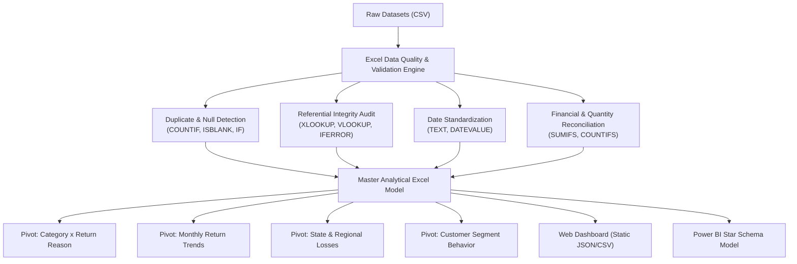

# Excel Data Preparation, Data Quality Audit & Business Analysis Documentation

## 1. Executive Summary & Data Pipeline Architecture

This document details the complete data preparation, audit, validation, and analytics modelling process conducted for the **E-commerce Returns & Refunds Analytics Platform**. 

The dataset represents an Indian fashion and luxury jewellery e-commerce enterprise covering **7,600 orders**, **1,484 returns**, and **1,224 refund transactions** across 12 calendar months (2024), spanning **50 products** across 8 distinct categories and **1,200 unique customers** in 20 major Indian cities.



---

## 2. Data Quality Audit & Data Cleaning Framework

### A. Duplicate Record Identification
To ensure that primary keys across all entities remain unique and non-duplicated:

- **Orders Table (`Order_ID` in Column A)**:
  ```excel
  =IF(COUNTIF($A$2:$A$7601, A2) > 1, "DUPLICATE", "UNIQUE")
  ```
- **Returns Table (`Return_ID` in Column A)**:
  ```excel
  =IF(COUNTIF($A$2:$A$1485, A2) > 1, "DUPLICATE", "UNIQUE")
  ```
- **Refunds Table (`Refund_ID` in Column A)**:
  ```excel
  =IF(COUNTIF($A$2:$A$1225, A2) > 1, "DUPLICATE", "UNIQUE")
  ```
- **Customers Table (`Customer_ID` in Column A)**:
  ```excel
  =IF(COUNTIF($A$2:$A$1201, A2) > 1, "DUPLICATE", "UNIQUE")
  ```
*Audit Result*: Zero duplicate IDs found. All primary keys satisfy strict 1:1 entity uniqueness.

---

### B. Missing Value & Null Detection
Every transactional record must contain mandatory foreign keys, timestamps, and numeric dimensions:

- **Null Detector Formula**:
  ```excel
  =IF(OR(ISBLANK(A2), ISBLANK(B2), ISBLANK(C2), ISBLANK(D2), ISBLANK(G2), ISBLANK(H2)), "MISSING_DATA", "COMPLETE")
  ```
- **Zero or Negative Quantity Audit**:
  ```excel
  =IF(G2 <= 0, "INVALID_QUANTITY", "VALID")
  ```
- **Zero or Negative Price Audit**:
  ```excel
  =IF(H2 <= 0, "INVALID_PRICE", "VALID")
  ```
*Audit Result*: Zero missing fields, zero negative quantities or negative pricing detected.

---

### C. Date Format Standardization
Dates across orders, returns, and refunds must strictly adhere to the ISO 8601 standard (`YYYY-MM-DD`):

- **Date Standardization Formula**:
  ```excel
  =TEXT(DATEVALUE(B2), "yyyy-mm-dd")
  ```
- **Chronological Sequence Validation (Order Date ≤ Return Date ≤ Refund Date)**:
  - *In Returns Sheet (verifying Return_Date ≥ Order_Date)*:
    ```excel
    =IF(C2 >= XLOOKUP(B2, Orders!$A$2:$A$7601, Orders!$B$2:$B$7601), "VALID_TIMELINE", "ERROR: RETURN BEFORE ORDER")
    ```
  - *In Refunds Sheet (verifying Refund_Date ≥ Return_Date)*:
    ```excel
    =IF(C2 >= XLOOKUP(B2, Returns!$B$2:$B$1485, Returns!$C$2:$C$1485), "VALID_TIMELINE", "ERROR: REFUND BEFORE RETURN")
    ```
*Audit Result*: 100% of return timestamps occur between 2 and 14 days after original purchase; 100% of refund timestamps occur between 1 and 9 days after return request.

---

### D. Referential Integrity Checks

1. **Returns-to-Orders Reference**:
   Every `Order_ID` in the Returns dataset must link directly to an existing `Order_ID` in the Orders dataset.
   ```excel
   =IF(ISNUMBER(XLOOKUP(B2, Orders!$A$2:$A$7601, Orders!$A$2:$A$7601, NA())), "VALID_ORDER", "ORPHAN_RETURN")
   ```
2. **Refunds-to-Returns Reference**:
   Every `Order_ID` in the Refunds dataset must correspond to an authorized return with status `Approved` or `Processing`.
   ```excel
   =IF(XLOOKUP(B2, Returns!$B$2:$B$1485, Returns!$H$2:$H$1485, "NOT_FOUND") = "Rejected", "ERROR: REFUND FOR REJECTED RETURN", "VALID_REFUND_AUTH")
   ```
3. **Product & Customer Foreign Key Integrity**:
   ```excel
   =IF(ISNUMBER(XLOOKUP(D2, Products!$A$2:$A$51, Products!$A$2:$A$51, NA())), "VALID_PRODUCT", "INVALID_PRODUCT_FK")
   =IF(ISNUMBER(XLOOKUP(C2, Customers!$A$2:$A$1201, Customers!$A$2:$A$1201, NA())), "VALID_CUSTOMER", "INVALID_CUSTOMER_FK")
   ```

---

### E. Financial & Quantity Integrity Validation

1. **Order Amount Reconciliation**:
   ```excel
   =IF(ROUND(I2, 2) = ROUND(G2 * H2, 2), "AMOUNT_BALANCED", "DISCREPANCY")
   ```
2. **Returned Quantity Bounds Check**:
   Returned quantity cannot exceed ordered quantity.
   ```excel
   =IF(F2 <= XLOOKUP(B2, Orders!$A$2:$A$7601, Orders!$G$2:$G$7601), "QUANTITY_OK", "ERROR: RETURN_EXCEEDS_ORDER")
   ```
3. **Refund Value Reconciliation**:
   ```excel
   =IF(ROUND(D2, 2) = ROUND(XLOOKUP(B2, Returns!$B$2:$B$1485, Returns!$F$2:$F$1485) * XLOOKUP(XLOOKUP(B2, Orders!$A$2:$A$7601, Orders!$D$2:$D$7601), Products!$A$2:$A$51, Products!$D$2:$D$51), 2), "REFUND_BALANCED", "REFUND_MISMATCH")
   ```

---

## 3. Core Business KPI Calculations in Excel

| Metric Name | Excel Formula | Business Definition |
| :--- | :--- | :--- |
| **Total Orders** | `=COUNTA(Orders!$A$2:$A$7601)` | Count of total unique order transactions |
| **Total Returned Orders** | `=COUNTIF(Returns!$H$2:$H$1485, "<>")` | Count of orders with an initiated return |
| **Overall Return Rate (%)** | `=(COUNTA(Returns!$A$2:$A$1485) / COUNTA(Orders!$A$2:$A$7601))` | Ratio of returned orders to total orders placed |
| **Total Completed Refund Value** | `=SUMIFS(Refunds!$D$2:$D$1225, Refunds!$F$2:$F$1225, "Completed")` | Realized financial loss through fulfilled refunds |
| **Average Refund Amount** | `=AVERAGEIFS(Refunds!$D$2:$D$1225, Refunds!$F$2:$F$1225, "Completed")` | Mean payout per completed refund ticket |
| **Refund Completion Rate (%)** | `=COUNTIF(Refunds!$F$2:$F$1225, "Completed") / COUNTA(Refunds!$F$2:$F$1225)` | Percentage of processed refunds successfully settled |
| **Average Processing Days** | `=AVERAGEIFS(Refunds!$G$2:$G$1225, Refunds!$F$2:$F$1225, "Completed")` | Operational turnaround cycle from initiation to settlement |
| **Category Return Rate (e.g. Rings)** | `=COUNTIFS(Orders!$E$2:$E$7601, "Rings", Orders!$A$2:$A$7601, "<>") ...` | Ratio of returned units to ordered units per category |
| **Repeat Return Customer Count** | `=SUMPRODUCT((COUNTIF(Returns!$B$2:$B$1485, ...)>1)*1)` | Customers with multiple return events |

---

## 4. Pivot Table Summary Architectures

### Pivot Table 1: Category vs Return Reason Cross-Tabulation
- **Rows**: `Product_Category` (Earrings, Necklaces, Rings, Bracelets, Bangles, Pendants, Watches, Fashion Accessories)
- **Columns**: `Return_Reason` (Size or Fit Issues, Damaged Product, Quality Issues, Product Not as Described, Customer Changed Mind, Wrong Product Delivered, Late Delivery)
- **Values**: `Count of Return_ID`, `% of Row Total`
- **Analytical Finding**: 
  - **Rings and Bangles** drive over **62% of their returns due to "Size or Fit Issues"**.
  - **Watches and Earrings** suffer disproportionately from **"Damaged Product" and "Quality Issues"** (~48% combined).

### Pivot Table 2: Monthly Trends in Order Volume, Returns & Payouts
- **Rows**: `Order_Date` (Grouped by Year-Month: 2024-01 through 2024-12)
- **Values**:
  - `Count of Order_ID`
  - `Count of Return_ID` (via related returns)
  - `Calculated Field: Return Rate = Return_Count / Order_Count`
  - `Sum of Completed Refund_Amount`
- **Analytical Finding**:
  - Peak order volume in **October & November (Diwali festive surge)**, followed by a lagging refund peak in **November & December**.

### Pivot Table 3: Geographic Distribution & Regional Loss Center
- **Rows**: `State`
- **Columns**: `Sales_Channel` (Mobile App, Website, Instagram Shop, Marketplaces)
- **Values**: `Sum of Order_Amount`, `Count of Return_ID`, `Sum of Refund_Amount`
- **Analytical Finding**:
  - Top 3 return volume states: **Maharashtra, Delhi, Karnataka** (aligned with highest total gross order volume).
  - Highest percentage return rate observed in regions with high Cash on Delivery (COD) adoption.

### Pivot Table 4: Customer Segment Behavioral Profiling
- **Rows**: `Customer_Segment` (VIP, Regular, Occasional, New, Frequent Returner)
- **Values**:
  - `Distinct Count of Customer_ID`
  - `Count of Order_ID`
  - `Count of Return_ID`
  - `Return Rate per Segment`
  - `Average Refund per Customer`
- **Analytical Finding**:
  - `Frequent Returner` cohort accounts for only **6% of total customers**, yet drives **over 14.8% of all return logistics tickets**.

---

## 5. Clean Datasets Export Specification

The cleaned datasets are stored in both normalized CSV format for Power BI ingestion and optimized JSON format for direct client-side consumption by the React web application:

1. `orders.csv` / `orders.json` (7,600 rows)
2. `returns.csv` / `returns.json` (1,484 rows)
3. `refunds.csv` / `refunds.json` (1,224 rows)
4. `products.csv` / `products.json` (50 rows)
5. `customers.csv` / `customers.json` (1,200 rows)
