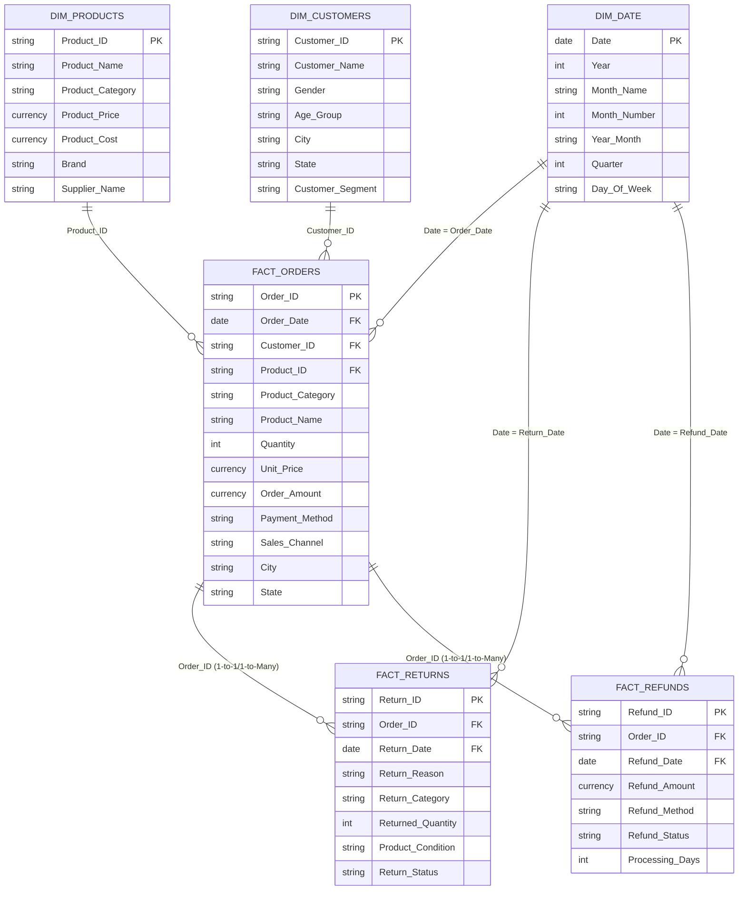

# Microsoft Power BI Analytics Architecture & DAX Measures Documentation

## 1. Relational Data Model Architecture (Star & Snowflake Hybrid)

The Power BI data model connects transactional facts with business dimensions to provide cross-filtering, drill-through, and time-intelligence capabilities.



---

## 2. Power Query (M Language) ETL Transformations

### A. Calendar / Date Dimension Table M-Script
```powerquery
let
    StartDate = #date(2024, 1, 1),
    EndDate = #date(2024, 12, 31),
    DayCount = Duration.Days(Duration.From(EndDate - StartDate)) + 1,
    DateList = List.Dates(StartDate, DayCount, #duration(1, 0, 0, 0)),
    DateTable = Table.FromList(DateList, Splitter.SplitByNothing(), {"Date"}, null, ExtraValues.Error),
    ChangedType = Table.TransformColumnTypes(DateTable, {{"Date", type date}}),
    AddYear = Table.AddColumn(ChangedType, "Year", each Date.Year([Date]), Int64.Type),
    AddMonth = Table.AddColumn(AddYear, "Month_Number", each Date.Month([Date]), Int64.Type),
    AddMonthName = Table.AddColumn(AddMonth, "Month_Name", each Date.MonthName([Date]), type text),
    AddYearMonth = Table.AddColumn(AddMonthName, "Year_Month", each Date.ToText([Date], "yyyy-MM"), type text),
    AddQuarter = Table.AddColumn(AddYearMonth, "Quarter", each "Q" & Text.From(Date.QuarterOfYear([Date])), type text),
    AddDayOfWeek = Table.AddColumn(AddQuarter, "Day_Of_Week", each Date.DayOfWeekName([Date]), type text)
in
    AddDayOfWeek
```

### B. Orders Table Ingestion & Type Enforcement
```powerquery
let
    Source = Csv.Document(File.Contents("orders.csv"), [Delimiter=",", Columns=13, Encoding=65001, QuoteStyle=QuoteStyle.Csv]),
    PromotedHeaders = Table.PromoteHeaders(Source, [PromoteAllScalars=true]),
    TypedTable = Table.TransformColumnTypes(PromotedHeaders, {
        {"Order_ID", type text},
        {"Order_Date", type date},
        {"Customer_ID", type text},
        {"Product_ID", type text},
        {"Product_Category", type text},
        {"Product_Name", type text},
        {"Quantity", Int64.Type},
        {"Unit_Price", Currency.Type},
        {"Order_Amount", Currency.Type},
        {"Payment_Method", type text},
        {"Sales_Channel", type text},
        {"City", type text},
        {"State", type text}
    })
in
    TypedTable
```

---

## 3. Comprehensive DAX Measures Library

### Core Volume & Operational KPIs

#### 1. Total Orders
```dax
Total Orders = 
DISTINCTCOUNT(Orders[Order_ID])
```

#### 2. Returned Orders
```dax
Returned Orders = 
CALCULATE(
    DISTINCTCOUNT(Orders[Order_ID]),
    USERELATIONSHIP(Orders[Order_ID], Returns[Order_ID]),
    NOT(ISBLANK(Returns[Return_ID]))
)
```

#### 3. Overall Return Rate (%)
```dax
Return Rate = 
DIVIDE([Returned Orders], [Total Orders], 0)
```
*Format: Percentage (`0.0%`)*

#### 4. Total Ordered Quantity
```dax
Total Ordered Quantity = 
SUM(Orders[Quantity])
```

#### 5. Total Returned Quantity
```dax
Total Returned Quantity = 
SUM(Returns[Returned_Quantity])
```

#### 6. Product Return Rate (%)
```dax
Product Return Rate = 
DIVIDE([Total Returned Quantity], [Total Ordered Quantity], 0)
```
*Format: Percentage (`0.0%`)*

---

### Financial & Refund KPIs

#### 7. Gross Sales Revenue
```dax
Gross Revenue = 
SUM(Orders[Order_Amount])
```
*Format: Currency (`₹#,##0`)*

#### 8. Total Completed Refund Amount
```dax
Total Refund Amount = 
CALCULATE(
    SUM(Refunds[Refund_Amount]),
    Refunds[Refund_Status] = "Completed"
)
```
*Format: Currency (`₹#,##0`)*

#### 9. Average Refund Amount
```dax
Average Refund Amount = 
CALCULATE(
    AVERAGE(Refunds[Refund_Amount]),
    Refunds[Refund_Status] = "Completed"
)
```
*Format: Currency (`₹#,##0`)*

#### 10. Refund Completion Rate (%)
```dax
Refund Completion Rate = 
DIVIDE(
    CALCULATE(COUNTROWS(Refunds), Refunds[Refund_Status] = "Completed"),
    COUNTROWS(Refunds),
    0
)
```
*Format: Percentage (`0.0%`)*

#### 11. Average Processing Days
```dax
Average Processing Days = 
CALCULATE(
    AVERAGE(Refunds[Processing_Days]),
    Refunds[Refund_Status] = "Completed"
)
```
*Format: Decimal (`0.0` Days)*

#### 12. Net Revenue After Returns & Refunds
```dax
Net Revenue = 
[Gross Revenue] - [Total Refund Amount]
```
*Format: Currency (`₹#,##0`)*

---

### Customer & Behavioral KPIs

#### 13. Total Customers
```dax
Total Customers = 
DISTINCTCOUNT(Orders[Customer_ID])
```

#### 14. Customers With Returns
```dax
Customers With Returns = 
CALCULATE(
    DISTINCTCOUNT(Orders[Customer_ID]),
    NOT(ISBLANK(Returns[Return_ID]))
)
```

#### 15. Customer Return Rate (%)
```dax
Customer Return Rate = 
DIVIDE([Customers With Returns], [Total Customers], 0)
```
*Format: Percentage (`0.0%`)*

#### 16. Repeat Return Customers
```dax
Repeat Return Customers = 
COUNTROWS(
    FILTER(
        VALUES(Orders[Customer_ID]),
        CALCULATE(DISTINCTCOUNT(Returns[Return_ID])) > 1
    )
)
```

---

## 4. Power BI 4-Page Report Specification

### Page 1: Executive Overview
- **Header & Slicers**: Date Range Slicer (Month/Year), Product Category dropdown, State dropdown.
- **Top KPI Cards**: 
  1. `[Total Orders]`
  2. `[Returned Orders]`
  3. `[Return Rate]`
  4. `[Total Refund Amount]`
  5. `[Average Refund Amount]`
  6. `[Refund Completion Rate]`
- **Visual 1 (Line and Clustered Column Chart)**: 
  - Shared Axis: `DimDate[Year_Month]`
  - Column Series: `[Total Orders]`
  - Line Series: `[Returned Orders]`, `[Return Rate]`
- **Visual 2 (Area Chart)**: Monthly Trend of `[Total Refund Amount]`.
- **Visual 3 (Clustered Bar Chart)**: Returns by `Product_Category`.
- **Visual 4 (Donut Chart)**: Distribution of `Return_Reason`.
- **Visual 5 (Donut Chart)**: Distribution of `Refund_Status`.

---

### Page 2: Returns Analysis
- **KPI Row**: `[Total Returned Orders]`, `[Return Rate]`, `Approved Returns`, `Rejected Returns`, `Pending Returns`.
- **Visual 1 (Horizontal Bar Chart)**: Top 10 Most Returned Products by Returned Quantity.
- **Visual 2 (Treemap)**: Return Reasons hierarchical breakdown by `Return_Category` -> `Return_Reason`.
- **Visual 3 (Stacked Bar Chart)**: Product Condition Distribution by Category (Resellable vs Damaged vs Unopened).
- **Visual 4 (Matrix Table)**:
  - Rows: `Product_Category`, `Product_Name`
  - Columns: `Return_Reason`
  - Values: `[Returned Orders]`, `[Total Returned Quantity]`, `[Product Return Rate]`
- **Visual 5 (Detailed Transaction Table)**: `Return_ID`, `Order_ID`, `Return_Date`, `Product_Name`, `Return_Reason`, `Condition`, `Status`.

---

### Page 3: Refund Analytics
- **KPI Row**: `[Total Refund Amount]`, `Completed Refunds Count`, `Pending Refunds Count`, `[Average Refund Amount]`, `[Average Processing Days]`.
- **Visual 1 (Combo Chart)**: Monthly Refund Payout vs Average Processing Days.
- **Visual 2 (Bar Chart)**: Refund Amount by `Product_Category`.
- **Visual 3 (Donut Chart)**: Refund Method Distribution (UPI Direct, Original Payment Method, Wallet, Bank Transfer).
- **Visual 4 (Histogram/Column Chart)**: Processing Days Distribution (1 day, 2 days, ..., 9+ days).
- **Visual 5 (Audit Matrix)**: Payment Method vs Refund Method Settlement Flow.

---

### Page 4: Product & Customer Analysis
- **KPI Row**: `[Total Customers]`, `[Customers With Returns]`, `[Repeat Return Customers]`, `[Customer Return Rate]`.
- **Visual 1 (Scatter Plot - Return Anomaly Matrix)**:
  - X-Axis: Gross Revenue by Product
  - Y-Axis: Product Return Rate (%)
  - Bubble Size: Total Returned Quantity
  - Legend: Product Category
  - *Identifies high-revenue products with anomalous return spikes!*
- **Visual 2 (Bar Chart)**: Return Rate by `Customer_Segment` (VIP vs Regular vs Frequent Returner).
- **Visual 3 (Table)**: Top 15 Customers by Total Refund Amount (identifying abuse/policy leakage).
- **Visual 4 (Choropleth / Bar Chart)**: State-wise Return Rate and Refund Losses across India.
